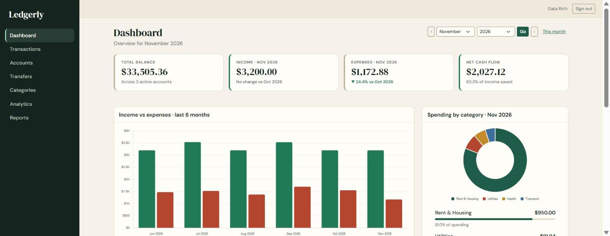
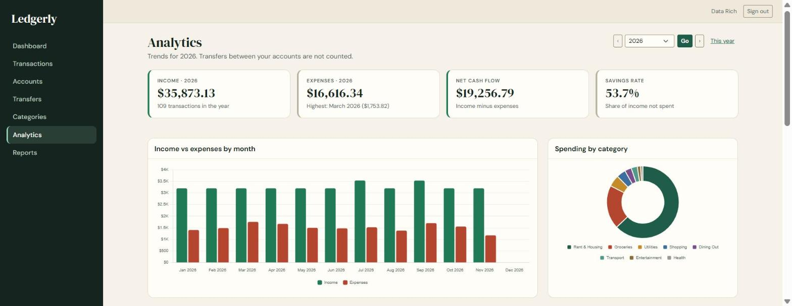
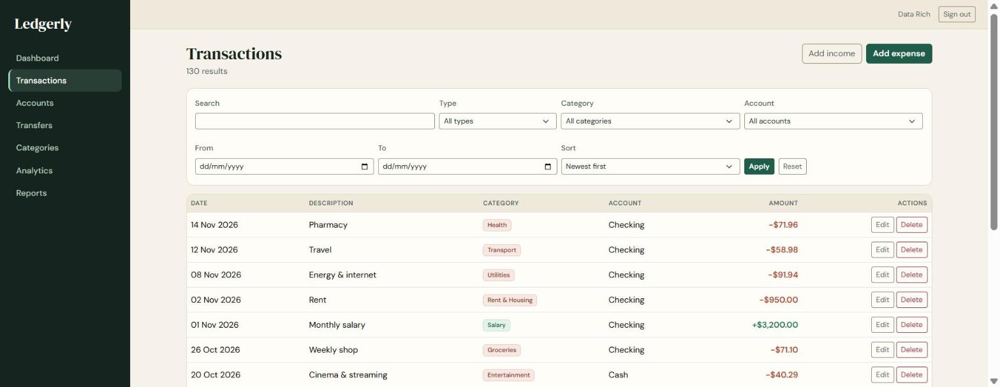
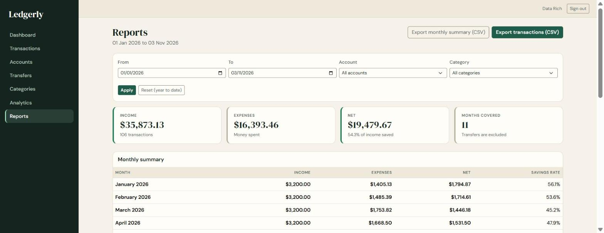

# Ledgerly: Personal Finance Tracker

A full-stack personal finance web application built with **Flask** and **MySQL 8**.
Track income and expenses across multiple accounts, move money between them,
and understand your finances through a dashboard, analytics and exportable reports.


> **Status:** Phases 1-4 are complete (authentication, accounts, transactions,
> transfers, categories, dashboard, analytics, reports). Budget management is the
> next phase. See the [roadmap](#roadmap).

## Screenshots

> Captured from a real browser session using generated demo data.

**Dashboard**: balances, monthly income and expenses, change versus last month, a 6-month trend and spending by category.



**Analytics**: a full year of income and expenses, spending by category, and a month-by-month comparison.



**Transactions**: search, filter, sort and paginate, with edit and delete (with confirmation) on every row.



**Reports**: any date range, account and category, with a monthly summary and CSV export.



**Sign in**


## Features

**Accounts and money movement**
- Multiple accounts (cash, checking, savings, credit card, investment, other)
- Balances are **calculated** from the opening balance plus transactions and transfers, never stored, so they cannot drift out of sync
- Transfers between your own accounts that are never counted as income or expenses
- Archive an account once its balance is zero; archived accounts are read-only and can be restored

**Transactions and categories**
- Add, edit and delete income and expense transactions, with a confirmation dialog on delete
- Search by description, filter by type, category, account and date, sort by date or amount, and paginate
- Default categories for every new user, plus custom categories with sensible rules (a category in use cannot be deleted or re-typed)

**Dashboard, analytics and reports**
- Monthly dashboard: total balance, income, expenses, net cash flow, savings rate, change versus the previous month, and recent transactions
- Interactive [Chart.js](https://www.chartjs.org/) charts: income vs expenses, spending by category, cash-flow trend with running total
- Year analytics with a month-by-month comparison table
- Reports filtered by date range, account and category, with **CSV export** of transactions and a monthly summary
- A configurable display currency (`CURRENCY_CODE` / `CURRENCY_LOCALE`)

**Interface**
- Responsive Bootstrap 5 layout with sidebar navigation (slide-out menu on small screens)
- Keyboard accessible, with a skip link, labelled form errors, text alternatives for every chart, and colours checked against WCAG AA contrast

## Security and data integrity

| Concern | How it is handled |
|---|---|
| Passwords | Hashed with scrypt (salted per password); uniform "invalid email or password" errors; timing equalised for unknown emails |
| Sessions and forms | CSRF protection on every state-changing form; HttpOnly, SameSite cookies; open-redirect protection on `?next=` |
| Secrets | Read from a local `.env` that is git-ignored; `.env.example` holds placeholders only; database passwords are URL-escaped and masked in logs |
| Data isolation | Every query is scoped to the signed-in user; other users' records return 404. At the database level, **composite foreign keys** `(user_id, id)` make MySQL itself reject a transaction that points at another user's account or category |
| Money | Stored as `DECIMAL(14,2)` and calculated with Python `Decimal`; `NaN`, infinity, more than two decimal places and out-of-range values are rejected; no floats |
| SQL | SQLAlchemy ORM only, with whitelisted sort keys and escaped `LIKE` wildcards |
| CSV export | Spreadsheet formula injection is neutralised (cells starting with `=`, `+`, `-` or `@` are prefixed) |
| Errors | Database errors are logged by class only, never with SQL or user data |
| Frontend | Bootstrap and Chart.js are pinned with Subresource Integrity hashes; JSON for charts is embedded safely |

## Tech stack

Python 3.12 · Flask · Flask-SQLAlchemy · Flask-Migrate (Alembic) · Flask-Login · Flask-WTF ·
MySQL 8 (PyMySQL) · Jinja2 · Bootstrap 5 · Chart.js · Babel · pytest

## Getting started

### Prerequisites
- Python 3.12 or newer
- MySQL Server 8.0 (MySQL Workbench is handy for managing it)
- Git

### 1. Clone and create a virtual environment

```powershell
git clone https://github.com/Yaseen-Ammar/-personal-finance-tracker.git
cd ./-personal-finance-tracker
python -m venv .venv
.\.venv\Scripts\Activate.ps1          # macOS/Linux: source .venv/bin/activate
pip install -r requirements.txt
```

> The repository name starts with a hyphen, so use the `./` prefix shown above or the shell may read it as an option.

### 2. Create the database

In MySQL Workbench (or the `mysql` client) run:

```sql
CREATE DATABASE IF NOT EXISTS personal_finance_tracker
  CHARACTER SET utf8mb4 COLLATE utf8mb4_0900_ai_ci;
```

### 3. Configure your environment

```powershell
Copy-Item .env.example .env           # macOS/Linux: cp .env.example .env
```

Open `.env` in your editor and fill in your values. **Never commit this file** (it is already in `.gitignore`).

| Variable | Purpose |
|---|---|
| `SECRET_KEY` | Signs session cookies. Generate one with `python -c "import secrets; print(secrets.token_hex(32))"` |
| `MYSQL_USER`, `MYSQL_PASSWORD` | Your MySQL credentials |
| `MYSQL_HOST`, `MYSQL_PORT`, `MYSQL_DATABASE` | Defaults: `localhost`, `3306`, `personal_finance_tracker` |
| `CURRENCY_CODE` | ISO 4217 code, e.g. `USD`, `GBP`, `EUR` (default `USD`) |
| `CURRENCY_LOCALE` | Number format, e.g. `en_US`, `en_GB`, `de_DE` (default `en_US`) |

Check the connection:

```powershell
python -m scripts.check_db
```

### 4. Create the tables and run the app

```powershell
flask db upgrade
flask run
```

Open <http://127.0.0.1:5000>, register an account, and create your first account to get started.
Use `flask run --debug` while developing so templates and code reload automatically.

## Running the tests

```powershell
pytest                                                  # full suite
pytest --cov=app --cov=config --cov-report=term-missing # with coverage
```

The suite (450+ tests, about 98% coverage) runs on in-memory SQLite and covers models,
authentication, access control, validation, balance calculations, transfers, analytics,
reports and CSV export. Behaviour that depends on MySQL itself (composite foreign keys,
`CHECK` constraints, grouped aggregates under `ONLY_FULL_GROUP_BY`) was additionally
verified against a real MySQL 8 server.

## Project structure

```
app/
  __init__.py        application factory, Jinja filters, error handlers
  models/            SQLAlchemy models (users, accounts, categories, transactions, transfers, budgets)
  services/          business logic: balances, transactions, transfers, analytics, reports, validation
  auth/ main/        sign-in, sign-up, dashboard
  accounts/ transactions/ transfers/ categories/ analytics/ reports/   blueprints (thin routes, forms)
  templates/ static/ Jinja templates, CSS and JavaScript
migrations/          Alembic migrations
scripts/             database connection check
tests/               pytest suite
config.py            environment-based configuration
```

Routes stay thin: they validate input and call a **service**, which holds the business rules.
Every blueprint that handles financial data is created through a helper that enforces login,
so a new route cannot be added without authentication by forgetting a decorator.

## Design notes

- **Balances are derived, not stored.** `opening balance + income - expenses + transfers in - transfers out`.
- **A transfer is one row**, so it can never be half-applied, and it lives outside the `transactions` table so it cannot inflate income or expenses.
- **Archived accounts** leave balances and totals, but their history stays in period reports so past months never change retroactively.
- **Deleting accounts or users** is intentionally not offered yet: transactions use `ON DELETE RESTRICT` to protect history.

## Roadmap

- [x] Phase 1: project setup and MySQL connection
- [x] Phase 2: models, migrations and authentication
- [x] Phase 3: accounts, transactions, categories and transfers
- [x] Phase 4: dashboard, analytics and reports (CSV export)
- [ ] Phase 5: monthly category budgets with progress tracking
- [ ] Phase 6: hardening, login rate limiting and a custom 500 page
- [x] Screenshots (desktop; mobile screenshots still to add)
- [ ] Phase 7: final polish and documentation

## Known limitations

- Charts load Chart.js from a CDN, so they need an internet connection (tables and totals still work offline).
- Transfers can be deleted but not edited, and accounts can be archived but not deleted.
- Budgets exist in the database schema but have no user interface yet.

## License

Released under the [Apache License 2.0](LICENSE).
